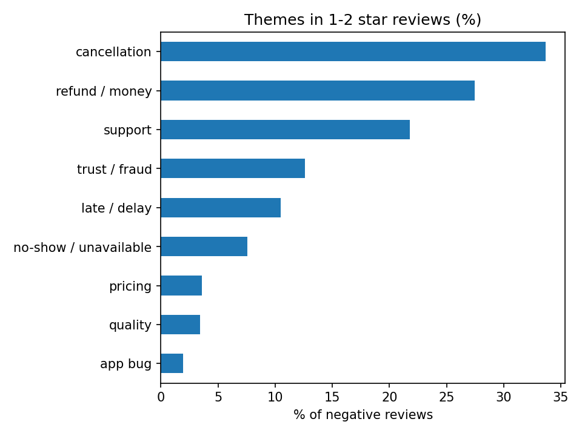
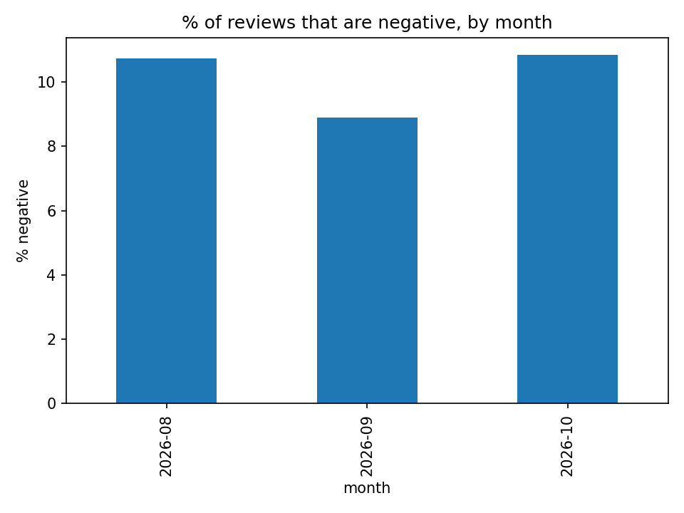

# Pronto App Review Analysis

I analyzed public Google Play reviews of the Pronto house-help app to find out what unhappy customers complain about the most.

*This is a personal learning project. I used only public Play Store reviews, and I am not affiliated with Pronto.*

## What I wanted to find out

What do customers complain about in 1-2 star reviews, and does the pattern change over time?

## Data

- **Source:** Public Google Play Store reviews of Pronto, collected with the `google-play-scraper` Python library
- **Size:** 20,000 of the newest reviews, from 26 August 2026 to 21 October 2026 (about 8 weeks)
- **Negative reviews:** 1,947 reviews with 1-2 stars (9.7% of the total)
- **What I kept:** only the review text, star rating and date. I did not save usernames or any personal data.

## How I did it

1. Downloaded the newest reviews and saved them in a CSV file.
2. Cleaned the text (made it lowercase, handled empty reviews) and converted the dates.
3. Marked reviews with 1-2 stars as **negative**.
4. Made keyword lists for each complaint theme: cancellation, refund/money, support, trust/fraud, late/delay, no-show, pricing, quality and app bug.
5. Calculated what percentage of negative reviews mention each theme, overall and month by month.
6. Checked how often cancellation complaints also mention refunds or support.
7. Read a random sample of reviews myself to check that my keywords work properly.

## What I found

Percentage of negative reviews mentioning each theme:

| Theme | Share of negative reviews |
|---|---|
| Cancellation | 33.7% |
| Refund / money | 27.5% |
| Support | 21.8% |
| Trust / fraud | 12.6% |
| Late / delay | 10.5% |
| No-show / unavailable | 7.6% |
| Pricing | 3.6% |
| Quality | 3.4% |
| App bug | 2.0% |

1. **Cancellation is the most common complaint.** About 33.7% of negative reviews mention it, and the share stays steady across the period (34.1% in August, 32.2% in September, 35.7% in October). August and October are partial months.
2. **Cancellation complaints often involve money.** 41.3% of cancellation reviews also mention refunds or money, compared with 27.5% of all negative reviews.
3. **Quality and pricing are rarely mentioned** (3.4% and 3.6%). So the main problem seems to be reliability and how issues are handled, not the cleaning itself.
4. **Some reviewers use words like fraud or scam** (12.6% of negative reviews). These are customers' opinions, but it suggests that broken bookings can hurt trust.




## Ideas for the product

- Tell customers early when no professional is available, and offer to rebook automatically instead of cancelling at the last minute.
- Make refunds or credits for cancelled bookings quick and easy to see in the app.
- Make sure support can actually solve the problem, not only reply.

## Limitations

- I only used about 8 weeks of Play Store reviews. No App Store data.
- Unhappy customers are more likely to write reviews, so these numbers describe reviewers, not all customers.
- Keyword matching is rough, so the percentages are approximate.
- Calling 1-2 star reviews "negative" is a simple rule.
- August and October are partial months, so month-to-month changes should be read carefully.

## What I want to do next

- Try a sentiment or topic model instead of keywords and compare the results.
- Add App Store reviews and one or two competing apps.
- Build a small professional-to-booking matching prototype using synthetic data.

## How to run it

```
pip install google-play-scraper pandas matplotlib
```

Open the notebook and run all the cells. The first run downloads the reviews, and later runs reuse the saved CSV.

## Tools used

Python, pandas, matplotlib, google-play-scraper, Jupyter Notebook

## About me

Poorna Chandrika, B.E. CSE (AI & ML), Stanley College of Engineering and Technology for Women, Hyderabad
GitHub: [your GitHub link] | LinkedIn: [your LinkedIn link]
